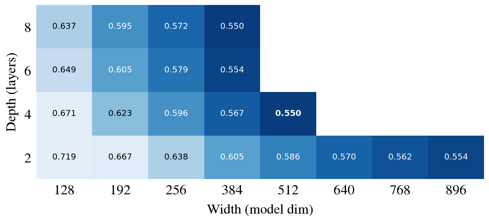
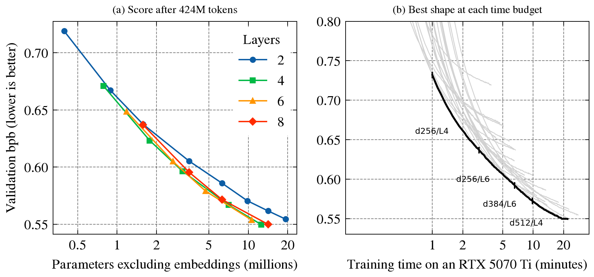
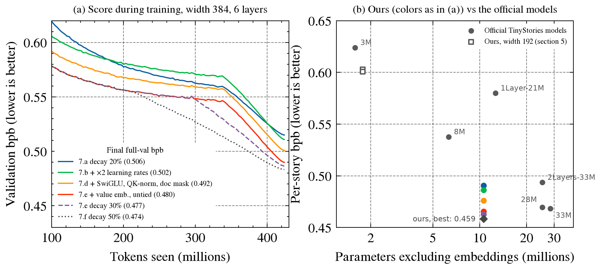
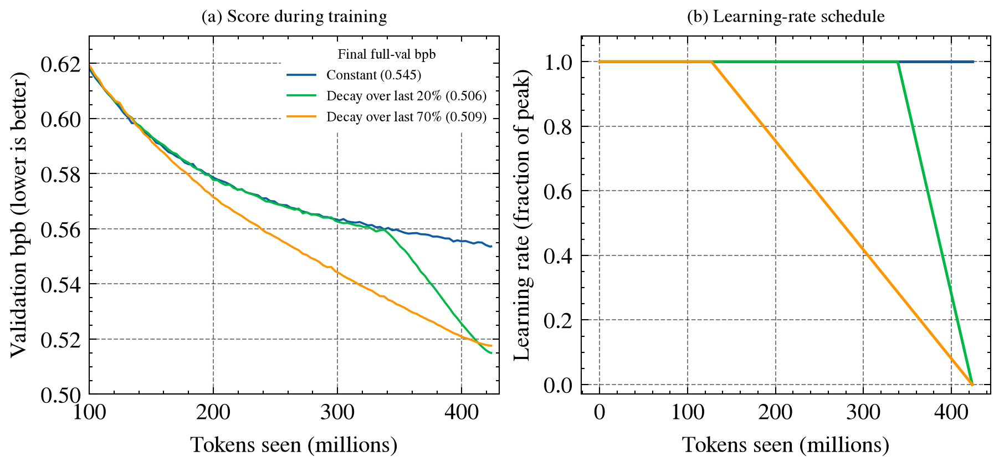

# tinystories

We train small GPT-style language models on [TinyStories](https://huggingface.co/datasets/roneneldan/TinyStories), a dataset of short, simple children's stories. These notes record what we tried and what we learned, in the order we did it.

**How to read the numbers.** We score each model by **bits per byte (bpb)** on held-out stories. Lower is better. It measures how well the model predicts the next character of text. We use it instead of the usual "loss" because loss depends on how text is split into tokens, so loss can't be compared between models with different tokenizers. bpb can.

**Setup for all runs below** (unless noted): 4 layers, width 192, a tokenizer we train ourselves, Muon optimizer for the main weight matrices and AdamW for everything else, a constant learning rate (no warmup or decay), one seed per setting.

**Current best settings:** 16k vocabulary, AdamW lr 0.04, Muon lr 0.0036, no warmup, learning rate decaying to zero over the last 50% of training (section 7). These are the training defaults in `src/tinystories/config.py`. Model: width 384, 6 layers, with `--model.mlp swiglu --model.qk-norm --model.doc-mask --model.value-embeds 2 --model.no-tie-embeddings` (section 7). These model options are flags, not defaults, so older checkpoints still load as they were trained. For model shape, use 4–6 layers and as much width as the time budget allows (section 6).

Figures are in `results/`. To redraw them from wandb: `uv run python results/plot.py`.

## 1. Vocabulary size, first try (2026-11-06)

**Question:** How many tokens should the tokenizer have?

We trained the same model with four vocabulary sizes on about 430M tokens each, using our original learning rates (AdamW 0.001, Muon 0.02). These learning rates turned out to be far from the best (see section 2), so section 4 repeats this experiment with better ones.

wandb group: `vocab-d192-oldlr`

| Vocab size | bpb (lower is better) | Time per training step |
|---|---|---|
| 4,096 | 0.768 | 20 ms |
| 8,192 | 0.751 | 23 ms |
| 16,384 | 0.744 | 26 ms |
| 32,768 | 0.744 | 33 ms |

**What we learned:**
- **Going past 16k didn't help.** 16k and 32k scored the same. TinyStories uses a small set of simple words, so a 16k vocabulary already covers them.
- **Bigger vocabularies are slower.** For a model this small, most of the computation goes into choosing among all possible tokens at the output, so a bigger vocabulary costs more time per step.
- **Bigger vocabularies started slowly.** Early in training they scored worse and only caught up later. Section 4 shows this was caused by the learning rate being too low.
## 2. Learning rates at 250M tokens (2026-11-06)

**Question:** What learning rates should we use? The model has two optimizers, each with its own learning rate:
- **AdamW lr:** trains the word embeddings and output layer. With a 16k vocab, these are about two-thirds of the model's weights.
- **Muon lr:** trains the weight matrices inside the transformer layers.

We searched in rounds (16k vocab, 250M tokens each). Each round tried every combination of a few values, moving toward the best result of the previous round and then zooming in. Blank cells were not tried.

wandb group: `lr-d192-v16k-250M`

*Final validation bpb for each pair of learning rates. Darker is better. Starred cells are the average of 3 seeds; the rest are single runs. Blank cells were not tried.*

**What we learned:**
- **The AdamW lr matters most.** Going from the old default (0.001) to 0.03 improved the score from 0.81 to 0.63. Changing the Muon lr moves the score far less. That makes sense: the AdamW lr trains the embeddings and output layer, which are most of this model's weights.
- **The best region is wide and flat.** Anything with AdamW 0.02–0.03 and Muon 0.0018–0.0025 scores 0.634. Repeating a run with a different random seed changes its score by about ±0.0015, which is bigger than the differences between these settings.
- **Too high is gentler than too low.** AdamW 0.3 (10× too high) scores 0.676; AdamW 0.003 (10× too low) scores 0.693. No setting we tried made training blow up.
- **Our old defaults were well off.** The tuned setting on 250M tokens beats the old default trained on twice as much data (0.634 vs 0.744).

## 3. Does the best learning rate depend on training length? (2026-11-07)

**Question:** We tuned at 250M tokens but train for 500M. Is the best learning rate the same?

A useful trick: with a constant learning rate, a run's score after T tokens is exactly what a T-token run would have scored. So the curves from the runs in section 2 already tell us the best learning rate at every length up to 250M. To go further we ran a small grid at 500M tokens.

wandb group: `lr-d192-v16k-500M`

*Each line is one training length. The y-axis is how far each setting is from the best setting at that length, so every line's best point sits at 0 (the larger dot). Lines up to 200M come from the 250M runs, with the other learning rate fixed at AdamW 0.03 / Muon 0.0025. The 420M line comes from the 500M runs, with the other learning rate fixed at AdamW 0.02 / Muon 0.0018.*

*Final validation bpb at 500M tokens, single runs. Darker is better.*

**What we learned:**
- **Yes: the longer you train, the lower the best learning rate.** The best AdamW lr goes from about 0.1 at 25M tokens to 0.045 at 100M, 0.02–0.03 at 250M, and 0.02 at 500M. The Muon lr follows the same pattern (about 0.01 down to 0.0018). A high learning rate learns fast early on but leaves the model "noisier" at the end, so longer runs benefit from a lower one.
- **At 500M tokens the best setting is AdamW 0.02, Muon 0.0018** (0.6176). The 250M winner (0.03 / 0.0025) scores 0.6220 here. That's a small difference, but it's about 3× the seed noise, and Muon 0.0018 is best in every row.
- **For runs longer than 500M, expect to need lower learning rates again.**

## 4. Vocabulary size, with tuned learning rates (2026-11-07)

**Question:** Does the vocabulary result from section 1 change with good learning rates?

Same as section 1 (about 430M tokens) but with AdamW 0.02 / Muon 0.0018. The 16k run is the matching run from section 3.

wandb group: `vocab-d192-tunedlr` (16k run in `lr-d192-v16k-500M`)

| Vocab size | bpb, old learning rates | bpb, tuned learning rates |
|---|---|---|
| 4,096 | 0.768 | 0.648 |
| 8,192 | 0.751 | 0.625 |
| 16,384 | 0.744 | 0.618 |
| 32,768 | 0.744 | **0.615** |

**What we learned:**
- **Tuning the learning rates helped every vocabulary size by about 0.12 bpb**, much more than any change of vocabulary did.
- **The slow start is gone.** With the old learning rates, bigger vocabularies were far behind early in training (after 1,000 steps: 1.71 bpb at 4k vs 2.17 at 32k). With tuned learning rates, all of 8k, 16k and 32k are at about 0.81 after 1,000 steps. The slow start was the embeddings learning too slowly, not something about big vocabularies.
- **Bigger is now slightly better all the way to 32k**, but with diminishing returns: 4k → 8k gains 0.023, 8k → 16k gains 0.007, 16k → 32k gains 0.003. The last step is about the size of seed noise.
- **If training time is the limit, 8k or 16k is best.** Each 32k step is about 30% slower than a 16k step. After 4 minutes of training, 8k (0.637) and 16k (0.638) lead 32k (0.646) and 4k (0.659).
- **Caveat:** we tuned the learning rate at 16k and used it for every vocabulary size. The best AdamW lr may be different for very small or very large vocabularies, since it trains the embeddings.

## 5. Comparison with the official TinyStories models (2026-11-07)

**Question:** How does our best model compare to the models released with the TinyStories paper (Eldan & Li, 2023)?

We scored our two best models and the seven official models on the same validation stories. Each story is scored on its own, from the start, using bits per byte, so the different tokenizers don't matter. We used the 21,427 stories (97% of the split) that fit in our 512-token context. These numbers are lower than our training-time bpb because there every 512-token window starts mid-story, with no earlier context.

Script: `results/eval_official.py`. Raw numbers: `results/official_eval.json`. Samples from every model on the same prompts: `results/generations.md`.

| Model | bpb (lower is better) | Parameters | Parameters excluding embeddings |
|---|---|---|---|
| TinyStories-33M | **0.468** | 68.5M | 28.3M |
| TinyStories-28M | 0.470 | 52.0M | 25.2M |
| TinyStories-2Layers-33M | 0.494 | 78.7M | 25.2M |
| TinyStories-8M | 0.538 | 19.7M | 6.3M |
| TinyStories-1Layer-21M | 0.580 | 66.2M | 12.6M |
| **Ours, 32k vocab** | **0.601** | 8.1M | 1.8M |
| **Ours, 16k vocab** | 0.603 | 4.9M | 1.8M |
| TinyStories-3M | 0.624 | 8.3M | 1.6M |
| TinyStories-1M | 0.790 | 3.7M | 0.4M |

How the models are built, from each model's `config.json` on Hugging Face (`roneneldan/TinyStories-*`). Width is the size of each token's vector inside the model, depth is the number of layers, and a head is one of the parallel attention units in a layer.

| Model | Width | Depth (layers) | Heads | Head size | Vocab |
|---|---|---|---|---|---|
| TinyStories-33M | 768 | 4 | 16 | 48 | 50,257 |
| TinyStories-28M | 512 | 8 | 16 | 32 | 50,257 |
| TinyStories-2Layers-33M | 1024 | 2 | 16 | 64 | 50,257 |
| TinyStories-8M | 256 | 8 | 16 | 16 | 50,257 |
| TinyStories-1Layer-21M | 1024 | 1 | 16 | 64 | 50,257 |
| TinyStories-3M | 128 | 8 | 16 | 8 | 50,257 |
| TinyStories-1M | 64 | 8 | 16 | 4 | 50,257 |
| Ours | 192 | 4 | 3 | 64 | 16,384 or 32,768 |

All the official models are GPT-Neo models with the GPT-2 tokenizer, learned position embeddings (up to 2,048 positions), a GELU MLP 4× the width, and no dropout. Their layers alternate between full attention and local attention, which only looks at the previous 256 tokens. (The 1-layer model has only one full-attention layer.) Ours uses rotary position embeddings (RoPE), full attention in every layer, the same GELU MLP 4× the width, tied input and output embeddings, and a 512-token context.

**What we learned:**
- **Our model beats the official model of the same size.** TinyStories-3M has about the same number of weights as our 32k model (8.3M vs 8.1M in total, 1.6M vs 1.8M outside the embeddings). Ours scores 0.601 vs 0.624. Our 16k model does as well with 40% fewer weights.
- **The bigger official models are still much better.** The 8M model (3.5× our non-embedding size) scores 0.538, and the 28M–33M models score about 0.47. To get there we need a bigger model, not more tuning.
- **Generations:** ours write fluent sentences and proper story shapes ("Once upon a time… One day… From that day on…"). Like TinyStories-3M, they lose track of the plot: objects and characters change halfway through, and events don't follow from each other. The 28M and 33M models keep a consistent plot and characters, and their stories make sense from start to end.
- **Above about 4 layers, total size matters more than how it is split between width and depth.** The two best models are shaped in opposite ways: 33M is wide and shallow (width 768, 4 layers), and 28M is half as wide and twice as deep (512, 8 layers). They score almost the same (0.468 vs 0.470). Very shallow models do worse: 2Layers-33M has as many weights outside the embeddings as 28M (25.2M) but scores 0.494 vs 0.470. The models also differ in training data and tokenizer, so this is only suggestive.
- **The 1Layer-21M and 2Layers-33M models seem to have been trained on data with story metadata.** They often write `Summary:` / `Features:` lines, which probably costs them a little bpb on plain stories.
- **The dataset contains some garbled characters** (for example `’` instead of `’`), and our models sometimes reproduce them.

## 6. Model shape: width and depth (2026-11-07)

**Question:** For a fixed amount of training data, how wide and how deep should the model be? And for a fixed amount of training time?

We trained models of width 128 to 896 (the size of each token's vector inside the model) and depth 2 to 8 layers, all on the 16k vocabulary with the tuned learning rates (AdamW 0.02, Muon 0.0018). Each attention head is 64 wide, so wider models have more heads. Not every combination was run: widths 512 and up were only run at 2 layers, plus 512 at 4 layers. All runs used the same GPU (an RTX 5070 Ti).

The runs up to width 384 saw 424M tokens, one pass over the training stories. The wider ones were run later and saw 500M. To compare them fairly, every score below is taken at 424M tokens, from the validation score logged during training. Because the learning rate is constant and the data comes in the same order, a 500M run's score at 424M tokens is what a 424M run would have scored. These in-training scores use a fixed 655k-token slice of the validation split, which scores about 0.004–0.008 higher than the full validation split.

wandb group: `shape-v16k-500M` (the width 192, 4-layer run is the matching run from `lr-d192-v16k-500M`)

*Validation bpb after 424M tokens (lower is better). Darker is better; the best cell is bold. Blank cells were not run.*

*(a) Validation bpb after 424M tokens against the number of parameters outside the embeddings, one line per depth. (b) Validation bpb against training time. Gray lines are individual runs. The black line is the best score reached within each time budget, labelled with the shape that reaches it; a tick marks where the leader changes.*

**What we learned:**
- **Bigger is still better, and we haven't found the limit.** The best models are width 512 with 4 layers (0.550) and width 384 with 8 layers (0.550), a tie. Both have about 13–14M parameters outside the embeddings, 7–8× our earlier width-192 model (0.623). The 2-layer models are still improving at the largest width we ran (896). On the full validation split, width 512 with 4 layers scores 0.538 after its 500M tokens, our best so far.
- **From 4 to 8 layers, only total size matters.** In panel (a), the 4-, 6- and 8-layer lines lie on top of each other above about 3M parameters: at equal size they score within about 0.005 of each other, for example width 256 with 4 layers (3.2M parameters, 0.596) against width 192 with 8 layers (3.6M, 0.595). This matches what we saw in the official models (section 5).
- **2 layers is too shallow.** At equal size, 2-layer models score about 0.010–0.015 worse: width 512 with 2 layers scores 0.586 against 0.572 for width 256 with 8 layers (both 6.3M parameters), and width 768 with 2 layers scores 0.562 against 0.550 for width 384 with 8 layers (both 14.2M).
- **For a fixed time budget, use 4–6 layers and grow the width with the budget.** Panel (b): with 1–3 minutes, width 256 with 4 layers is best; with 3–6 minutes, width 256 with 6 layers; with 6–10 minutes, width 384 with 6 layers; and with 10–20 minutes, width 512 with 4 layers. Neither 2-layer nor 8-layer models are ever best: 8-layer models score as well for their size but run slower, because more layers means more steps one after the other and smaller matrix multiplies.
- **Not established yet:**
  - **Noise:** each shape was run once. Differences under about 0.0015 bpb (one seed's noise) are ties.
  - **Learning rates:** they were tuned only at width 192 with 4 layers. The model is set up so the learning rate should carry over to other widths (muP), but not to other depths, and we haven't checked either.
  - **Missing shapes:** the shapes most likely to win, width 512 at 6–8 layers and width 640 and up at 4–8 layers, were not run. A width-640, 4-layer run crashed at 39M tokens, and a width-1024, 2-layer run stopped at 168M tokens; both are left out.
  - **Time budgets:** the times include each run's startup and compile time (under a minute), and come from a run stopped partway, not from a run whose learning rate was planned for that length.

## 7. AI hill climb: width 384, 6 layers, one epoch (2026-11-07)

**Question:** How low can width 384 with 6 layers go in one epoch (423.7M tokens), and can it beat TinyStories-33M (0.468 per-story bpb, section 5)?

Claude ran this on its own with a 2-hour budget: at most one epoch, batch 64 × 512 tokens, 16k vocab, seed 0. Each change was tried on top of the best run so far. To save GPU time, some runs were split into a constant-rate "parent" that stops at step 10,343 (or 9,050) and a "branch" that trains only the decay from the parent's saved state. This gives the same result as one full run (checked on a small model: 1.6662 vs 1.6664 bpb). Per-story bpb is section 5's metric (`results/eval_perstory.py`), which can be compared with the official models. It runs about 0.015 below full-val bpb, so the two metrics can't be compared with each other. For models with document masking, the per-story numbers use the mask at every length. An earlier version applied it only to batches whose length was a multiple of 128, which scored these models 0.002–0.004 worse.

wandb groups: `decay-d384L6-v16k-424M` (7.a), `hillclimb-d384L6-v16k-424M` (7.b–7.f)

*(a) In-training validation bpb (a 655k-token slice) for each kept step; final full-val bpb in the legend. Runs split into parent and branch are drawn joined. (b) Per-story bpb against parameters outside the embeddings. Colored dots are our runs from (a), all with 10.6M; the diamond is the best.*

| Step | Change (kept on top of the previous row) | Full-val bpb (lower is better) | Per-story bpb (lower is better) |
|---|---|---|---|
| Start | Constant learning rate (section 6) | 0.5452 | 0.5299 |
| 7.a | Decay to zero over the last 20% | 0.5064 | 0.4908 |
| 7.b | ×2 learning rates (AdamW 0.04, Muon 0.0036) | 0.5020 | 0.4864 |
| 7.d | SwiGLU, QK-norm, document masking | 0.4918 | 0.4737 |
| 7.e | Value embeddings, untied output layer | 0.4802 | 0.4620 |
| 7.e | Decay over the last 30% instead of 20% | 0.4768 | 0.4586 |
| 7.f | Decay over the last 50% | **0.4737** | **0.4555** |
| | TinyStories-33M (section 5) | – | 0.468 |

**What we learned:**
- **We beat TinyStories-33M on its own metric: 0.4555 vs 0.468 per-story bpb,** with 10.6M weights in the layers vs 28.3M, and fewer weights in total (35.8M vs 68.5M; most of both are lookup tables). The margin is about 8× seed noise.
- **Decaying the learning rate to zero was the biggest win** (0.039), about as much as everything else combined.
- **With decay, the best learning rates are about twice the constant-rate ones,** and the architecture changes add about 0.022 on top.
- **Not established:** one seed per run (noise about ±0.0015); the five architecture changes were only tested in groups; learning rates and decay length were only lightly tuned on the final model; batch size was never changed.

### 7.a Learning-rate decay

*Same model and data order; only the schedule differs. Legend: final full-val bpb.*

- **Decay over the last 20%: 0.5064** (constant: 0.5452). The score drops almost in a straight line with the learning rate and is still falling when the rate reaches zero.
- **Decay over the last 70%: 0.5086,** close to a tie. It's far ahead mid-run because its rate drops sooner, but the 20% decay catches up at the end.
- Generations improve visibly: whole stories with a start, problem and ending, about TinyStories-8M quality by eye.

### 7.b Learning rates

- **×2 (AdamW 0.04, Muon 0.0036): 0.5020,** 0.0044 better than ×1. It's worse during the flat part (0.570 vs 0.560 at step 10,000) but gains more during the decay: the decay removes the extra jitter of a high rate and keeps its extra progress.
- **×0.5: stopped at step ~3,800,** far behind (0.644 vs about 0.61) with no sign of closing.

### 7.c Value embeddings and an untied output layer (×1 learning rates)

- **2 value-embedding tables + untied output layer: 0.5012,** 0.0052 better than 7.a. Value embeddings are extra token-embedding tables added to the attention values of the first two and last two layers (from the modded-nanogpt speedrun). They add 19M lookup weights and almost no compute. The run starts slower and pulls ahead after step 6,000.

### 7.d SwiGLU, QK-norm, document masking (×2 learning rates)

- **All three together: 0.4918,** 0.0102 better than 7.b, ahead at every step. SwiGLU is a gated MLP with the same weight count. QK-norm normalizes queries and keys, which keeps attention stable at high rates. Document masking stops attention from reaching into the previous story in the same window. Its first decay branch crashed on a bug in the new branching code (fixed); the rerun branched from the same saved state.

### 7.e Everything together

- **7.d + 7.c's changes, decay 20%: 0.4802** (per-story 0.4620). The 7.c changes gained 0.0116 here, more than at ×1 rates.
- **Same, decay 30%: 0.4768** (per-story 0.4586), best of 7.e. A branch from the step-9,050 state, so it cost 3,879 steps.
- **Same, ×3 learning rates, decay 20%: 0.4814** (per-story 0.4632), a tie with ×2.
- Generations keep a consistent plot and characters, with small slips left ("the birds came and ate them"); close to TinyStories-28M and 33M by eye.

### 7.f Decay length, and decaying to zero or not

**Question:** On the final model, is a longer decay better still, and should the learning rate end at zero or at a floor?

- **Decay over the last 50%: 0.4737 full-val, 0.4555 per-story. New best,** 0.0031 better than 30% (about 2× seed noise). It's behind the shorter decays until its rate starts dropping at step 6,465, then far ahead (0.518 vs 0.547 at step 10,000), and it's still ahead at the end. Its saved states at steps 3,879, 5,172 and 6,465 let 60–70% decays branch from it.
- **Decay over the last 20%, ending at 10% of the peak instead of zero: 0.4827,** 0.0025 worse than decaying to zero (0.4802), about 1.7× seed noise. It falls behind as soon as the schedules split, and the gap grows toward the end (0.4929 vs 0.4900 at step 12,900). So decay all the way to zero: the last, smallest steps still help. Per-story: 0.4644 vs 0.4620.

| Decay (final model, ×2 learning rates) | Full-val bpb (lower is better) | Per-story bpb (lower is better) |
|---|---|---|
| Last 20%, to zero | 0.4802 | 0.4620 |
| Last 20%, to 10% of peak | 0.4827 | 0.4644 |
| Last 30%, to zero | 0.4768 | 0.4586 |
| Last 50%, to zero | **0.4737** | **0.4555** |

- **Longer decays keep helping on this model:** 20% → 30% → 50% gains 0.0034, then 0.0031. In 7.a (×1 rates, older model) 70% was slightly worse than 20%, so the best length depends on the setup. 50% is the edge of what we tried here.

## 8. Generations: our best model vs the official models (2026-11-07)

**Question:** Section 7's best model beats TinyStories-33M on per-story bpb. Do its stories read as well?

We sampled 5 stories for each of 4 prompts (the section 5 prompts) from our best model (section 7.f: width 384, 6 layers, decay over the last 50%) and from TinyStories-33M, 28M and 8M. Temperature 0.8, no top-k, up to 300 tokens. Each model gets its own seeds. With shared seeds, the official models, which share a tokenizer, draw the same random numbers and start their stories almost identically. The official samples are cached, so reruns only generate ours.

Script: `results/compare_generations.py`. All 80 stories: `results/generations_compare.md`.

| | Ours (d384/L6) | TinyStories-33M | TinyStories-28M | TinyStories-8M |
|---|---|---|---|---|
| Average length (words) | 146 | 141 | 128 | 151 |
| Stories cut off at 300 tokens (of 20) | 0 | 0 | 1 | 1 |
| Quoted lines of dialogue | 53 | 33 | 42 | 30 |
| Distinct words per 100 words | 18.1 | 17.9 | 21.1 | 17.7 |

*Counts over each model's 20 stories. These are rough measures of style, not quality.*

**What we learned:**
- **Ours read about as well as TinyStories-28M and 33M.** All three write complete, coherent stories, and all make occasional small slips at about the same rate. Ours: Tom "barked at the truck driver"; a big bird advising "you need a small brain to fly". 33M: "a man sitting on her shoulder"; a bird that tries to "use that saw to soar"; Tom "was scared and barked".
- **Length and endings are similar.** Ours are about as long and always finish within 300 tokens. Ours use the most dialogue.
- **The one clear difference is how stories open.** All 5 of our unprompted stories start "Once upon a time, there was", though with different characters and plots (a boy making a kayak, Lily twice, Timmy, a rabbit's race). 33M varies its first line more ("John was a curious three-year-old…", "Once there was a strong little boy named Peter…").
- **Small samples mislead.** A first try with 3 samples per prompt and shared seeds suggested ours used less dialogue, often ended with "The moral of the story is", and always started with Lily. With 20 samples per model and separate seeds, none of that holds.
- **Not established:** this is one reader's judgment of 80 stories, not a blind or scored comparison.
