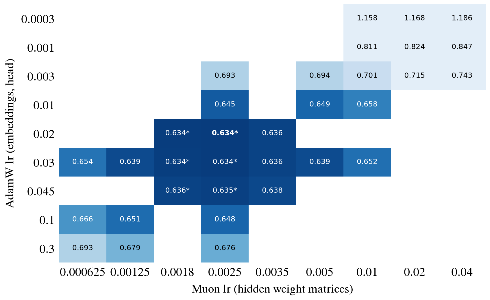
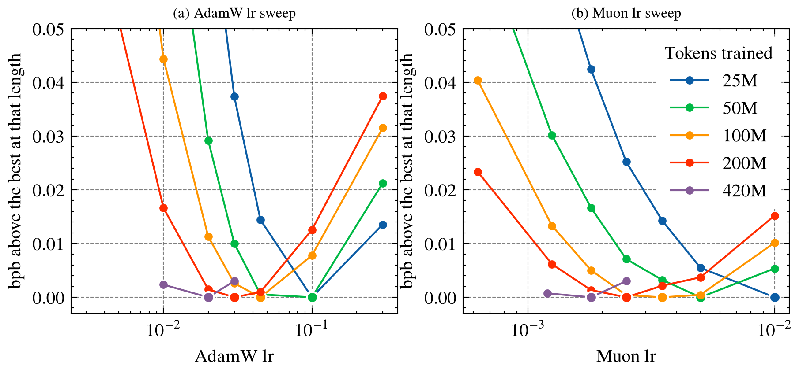
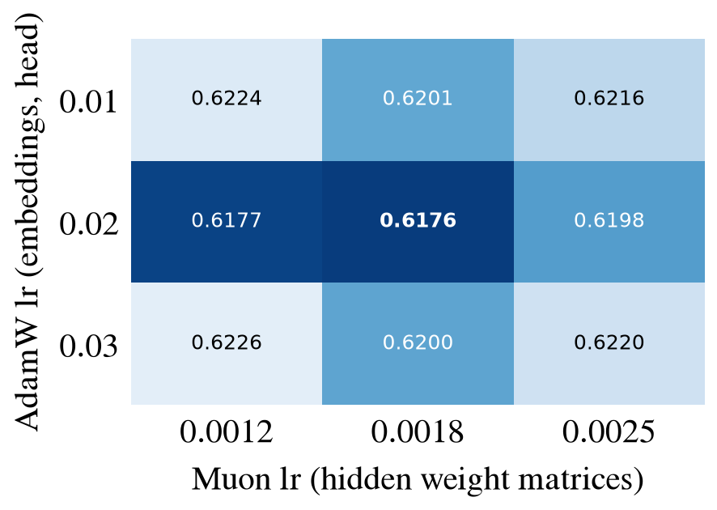
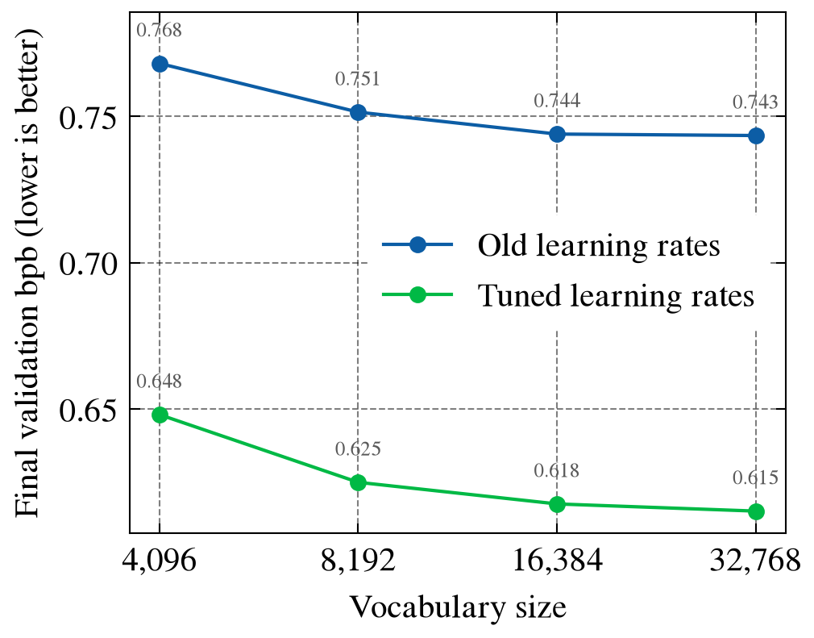
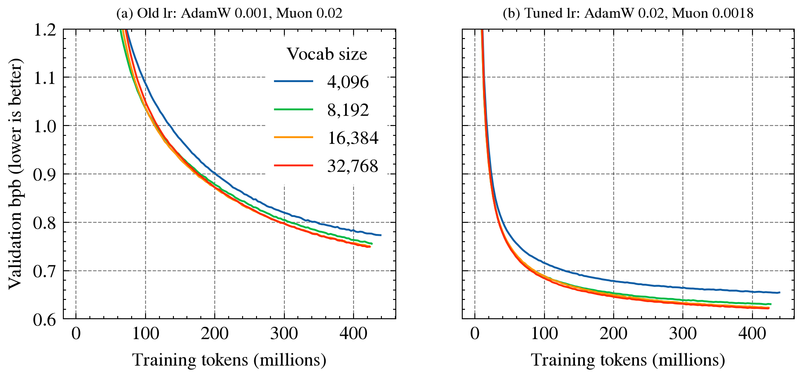
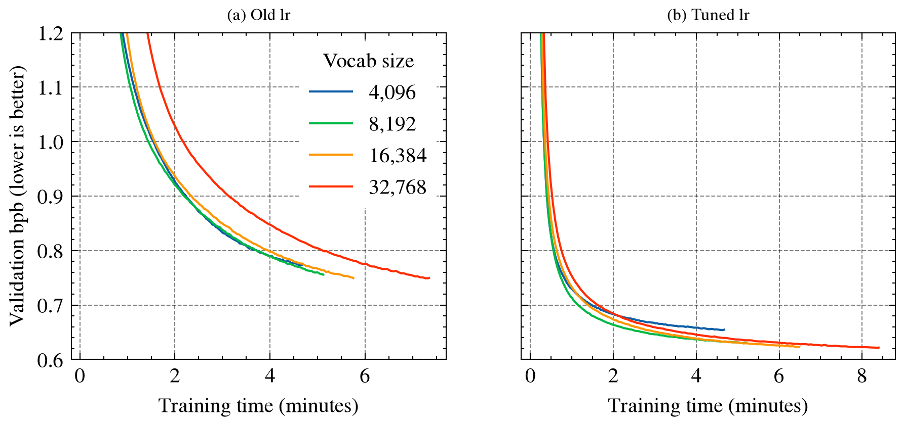

# tinystories

We train small GPT-style language models on [TinyStories](https://huggingface.co/datasets/roneneldan/TinyStories), a dataset of short, simple children's stories. These notes record what we tried and what we learned, in the order we did it.

**How to read the numbers.** We score each model by **bits per byte (bpb)** on held-out stories. Lower is better. It measures how well the model predicts the next character of text. We use it instead of the usual "loss" because loss depends on how text is split into tokens, so loss can't be compared between models with different tokenizers. bpb can.

**Setup for all runs below** (unless noted): 4 layers, width 192, a tokenizer we train ourselves, Muon optimizer for the main weight matrices and AdamW for everything else, a constant learning rate (no warmup or decay), one seed per setting.

**Current best settings:** 16k or 32k vocabulary, AdamW lr 0.02, Muon lr 0.0018 (tuned for 500M training tokens). These are the defaults in `src/tinystories/config.py`.

Figures are in `results/`. To redraw them from wandb: `uv run python results/plot.py`.

## 1. Vocabulary size, first try (2026-11-06)

**Question:** How many tokens should the tokenizer have?

We trained the same model with four vocabulary sizes on about 430M tokens each, using our original learning rates (AdamW 0.001, Muon 0.02). These learning rates turned out to be far from the best (see section 2), so section 4 repeats this experiment with better ones.

wandb group: `vocab-d192-oldlr`

| Vocab size | bpb (lower is better) | Time per training step |
|---|---|---|
| 4,096 | 0.768 | 20 ms |
| 8,192 | 0.751 | 23 ms |
| 16,384 | 0.744 | 26 ms |
| 32,768 | 0.744 | 33 ms |

**What we learned:**
- **Going past 16k didn't help.** 16k and 32k scored the same. TinyStories uses a small set of simple words, so a 16k vocabulary already covers them.
- **Bigger vocabularies are slower.** For a model this small, most of the computation goes into choosing among all possible tokens at the output, so a bigger vocabulary costs more time per step.
- **Bigger vocabularies started slowly.** Early in training they scored worse and only caught up later. Section 4 shows this was caused by the learning rate being too low.
asdfa
## 2. Learning rates at 250M tokens (2026-11-06)

**Question:** What learning rates should we use? The model has two optimizers, each with its own learning rate:
- **AdamW lr:** trains the word embeddings and output layer. With a 16k vocab, these are about two-thirds of the model's weights.
- **Muon lr:** trains the weight matrices inside the transformer layers.

We searched in rounds (16k vocab, 250M tokens each). Each round tried every combination of a few values, moving toward the best result of the previous round and then zooming in. Blank cells were not tried.

wandb group: `lr-d192-v16k-250M`

*Final validation bpb for each pair of learning rates. Darker is better. Starred cells are the average of 3 seeds; the rest are single runs. Blank cells were not tried.*

**What we learned:**
- **The AdamW lr matters most.** Going from the old default (0.001) to 0.03 improved the score from 0.81 to 0.63. Changing the Muon lr moves the score far less. That makes sense: the AdamW lr trains the embeddings and output layer, which are most of this model's weights.
- **The best region is wide and flat.** Anything with AdamW 0.02–0.03 and Muon 0.0018–0.0025 scores 0.634. Repeating a run with a different random seed changes its score by about ±0.0015, which is bigger than the differences between these settings.
- **Too high is gentler than too low.** AdamW 0.3 (10× too high) scores 0.676; AdamW 0.003 (10× too low) scores 0.693. No setting we tried made training blow up.
- **Our old defaults were well off.** The tuned setting on 250M tokens beats the old default trained on twice as much data (0.634 vs 0.744).

## 3. Does the best learning rate depend on training length? (2026-11-07)

**Question:** We tuned at 250M tokens but train for 500M. Is the best learning rate the same?

A useful trick: with a constant learning rate, a run's score after T tokens is exactly what a T-token run would have scored. So the curves from the runs in section 2 already tell us the best learning rate at every length up to 250M. To go further we ran a small grid at 500M tokens.

wandb group: `lr-d192-v16k-500M`

*Each line is one training length. The y-axis is how far each setting is from the best setting at that length, so every line's best point sits at 0 (the larger dot). Lines up to 200M come from the 250M runs, with the other learning rate fixed at AdamW 0.03 / Muon 0.0025. The 420M line comes from the 500M runs, with the other learning rate fixed at AdamW 0.02 / Muon 0.0018.*

*Final validation bpb at 500M tokens, single runs. Darker is better.*

**What we learned:**
- **Yes: the longer you train, the lower the best learning rate.** The best AdamW lr goes from about 0.1 at 25M tokens to 0.045 at 100M, 0.02–0.03 at 250M, and 0.02 at 500M. The Muon lr follows the same pattern (about 0.01 down to 0.0018). A high learning rate learns fast early on but leaves the model "noisier" at the end, so longer runs benefit from a lower one.
- **At 500M tokens the best setting is AdamW 0.02, Muon 0.0018** (0.6176). The 250M winner (0.03 / 0.0025) scores 0.6220 here. That's a small difference, but it's about 3× the seed noise, and Muon 0.0018 is best in every row.
- **For runs longer than 500M, expect to need lower learning rates again.**

## 4. Vocabulary size, with tuned learning rates (2026-11-07)

**Question:** Does the vocabulary result from section 1 change with good learning rates?

Same as section 1 (about 430M tokens) but with AdamW 0.02 / Muon 0.0018. The 16k run is the matching run from section 3.

wandb group: `vocab-d192-tunedlr` (16k run in `lr-d192-v16k-500M`)

| Vocab size | bpb, old learning rates | bpb, tuned learning rates |
|---|---|---|
| 4,096 | 0.768 | 0.648 |
| 8,192 | 0.751 | 0.625 |
| 16,384 | 0.744 | 0.618 |
| 32,768 | 0.744 | **0.615** |

**What we learned:**
- **Tuning the learning rates helped every vocabulary size by about 0.12 bpb**, much more than any change of vocabulary did.
- **The slow start is gone.** With the old learning rates, bigger vocabularies were far behind early in training (after 1,000 steps: 1.71 bpb at 4k vs 2.17 at 32k). With tuned learning rates, all of 8k, 16k and 32k are at about 0.81 after 1,000 steps. The slow start was the embeddings learning too slowly, not something about big vocabularies.
- **Bigger is now slightly better all the way to 32k**, but with diminishing returns: 4k → 8k gains 0.023, 8k → 16k gains 0.007, 16k → 32k gains 0.003. The last step is about the size of seed noise.
- **If training time is the limit, 8k or 16k is best.** Each 32k step is about 30% slower than a 16k step. After 4 minutes of training, 8k (0.637) and 16k (0.638) lead 32k (0.646) and 4k (0.659).
- **Caveat:** we tuned the learning rate at 16k and used it for every vocabulary size. The best AdamW lr may be different for very small or very large vocabularies, since it trains the embeddings.
